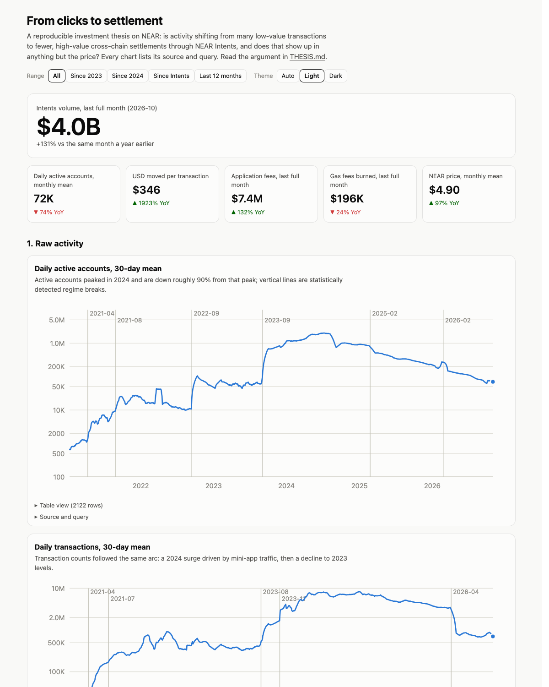

# From clicks to settlement: a reproducible, quality-adjusted investment thesis on NEAR

Built for the NEAR Hackathon 2026, track **Investment Thesis** (`thesis`). Work in progress until 2026-11-14.

**Claim under test.** NEAR's economic activity is shifting from high-count, low-value retail transactions
(the 2024 mini-app era) to lower-count, higher-value cross-chain settlement through NEAR Intents. Raw activity
metrics (transactions, active accounts) understate the network; value-weighted and quality-adjusted metrics
show growth decoupled from the token price. `THESIS.md` holds the claim, the evidence for it, the evidence
against it, and the result that would change our mind.

## What is in the box
| Layer | What it does | Where |
|---|---|---|
| L0 | Pulls public, key-less sources (NearBlocks, DefiLlama, NEAR RPC, CoinGecko, GitHub) into hashed raw snapshots | `near_thesis/fetch.py`, `data/raw/` |
| L1 | Quality-Adjusted Active Accounts: behavioral clustering of accounts (BigQuery account-months, or sampled blocks) | `sql/l1_*.sql`, `near_thesis/qaa.py`, `near_thesis/blocks.py` |
| L2 | NEAR Intents microstructure parsed from raw on-chain `token_diff` events (solver concentration, users, trade size) | `sql/l2_*.sql`, `near_thesis/intents.py`, `near_thesis/blocks.py` |
| L3 | Structural breaks, VAR / Granger, cointegration, rolling correlations | `near_thesis/econ.py` |
| L4 | Forward-return signal test and peer-chain relative valuation | `near_thesis/signal.py` |
| Out | `THESIS.md`, static dashboard in `site/`, executed notebook, on-chain index (stretch) | `near_thesis/thesis.py`, `near_thesis/site.py`, `near_thesis/onchain.py` |

## Reproduce (do X, see Y)
Requirements: [uv](https://docs.astral.sh/uv/) (it installs Python 3.12 itself). No Google credentials needed.

1. `uv sync --all-extras` -> a `.venv` is created with every dependency.
2. `make build` -> rebuilds every table, model output, chart and `THESIS.md`
   from the raw snapshots committed in `data/raw/` and `data/bigquery/`. You should see
   `data/derived/daily.csv`, `data/derived/models/*.json`, `site/index.html`, and a regenerated `THESIS.md`.
3. `make serve` -> open http://localhost:8080 and you should see the dashboard: every chart with its source
   query and one plain sentence.
4. `make test` -> unit tests for the metric functions pass.
5. Open `site/walkthrough.html` -> the executed notebook with every model output.
6. Optional, refresh data: `make fetch` (public APIs) and either `make blocks` (samples full blocks from FastNear's
   public block API, no credentials, ~1 hour) or `make bq` (BigQuery, see `docs/SETUP_BIGQUERY.md`; dry-runs every
   query and refuses any above `BQ_MAX_GB_PER_QUERY`). L1 and L2 use the BigQuery extract when present and the
   block sample otherwise; THESIS.md states which.
7. Optional, on-chain index: `make onchain` prints the payload that `make onchain SEND=1` would write to NEAR Social
   on testnet (needs `NEAR_ACCOUNT_ID` and `NEAR_PRIVATE_KEY` in `.env`; signing is a human decision).

## What NEAR does in this product
NEAR is both the subject and the data layer: NEAR RPC and FastNear's block API supply raw blocks, receipts and
`intents.near` event logs; the public BigQuery dataset `crypto_near_mainnet_us` supplies account-level history;
NEAR Social on testnet is where the index is published so the key numbers can be verified without trusting this repo.

## Data sources and integrity
Every number in `THESIS.md` and the dashboard is produced by the pipeline from the snapshots in `data/`.
Nothing is typed by hand. If a metric cannot be computed from these sources, `THESIS.md` says so.
Snapshot hashes are listed in `docs/REPRODUCIBILITY.md` (generated).

## Disclosure
Libraries: see `pyproject.toml`. Parts of the code were written with Claude Code (Anthropic); all queries,
models and conclusions were reviewed by the team. No pre-existing project was reused.

## License
MIT. See `LICENSE`.
